<p align="center">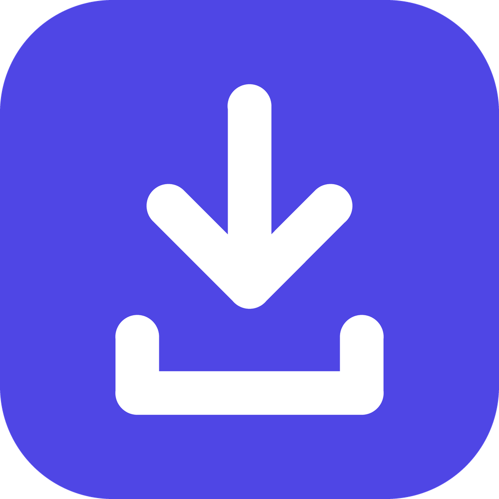</p>

# ytdl

**Website and downloads: <https://biswadipb.github.io/ytdl/>**

Download videos from **YouTube, Instagram, X/Twitter, Facebook, Threads, Dailymotion, TikTok, Reddit, Vimeo, Twitch and SoundCloud** to your own device, as
video or audio-only. Everything runs locally: no accounts, no web service. Saved files play offline.

| Site | Status |
|---|---|
| YouTube | Works |
| Instagram (posts, reels) | Works; many posts need a login (see below) |
| X / Twitter | Works for posts that contain video |
| Facebook (videos, reels) | Works for public videos; others need a login |
| Threads (posts with video) | Works. On desktop ytdl uses Chrome, Edge, Brave or Chromium if one is installed (Edge always is on Windows); on Android it uses the phone's built-in browser engine. See "How Threads works" below |
| Dailymotion | Works for videos that aren't region-locked |
| SoundCloud | Works (tested with a real track) |
| Vimeo | Supported, but Vimeo now asks for a login on many videos, so sign in first (see below) |
| TikTok, Reddit, Twitch (clips and past broadcasts) | Supported by the download engine; I couldn't test a real download from my network, so tell me if one fails |

**Formats:** video as `mp4`, `mkv` or `webm`; audio only as `mp3`, `m4a`, `opus`, `wav` or `flac`.

| Platform | App | Folder |
|---|---|---|
| Mac | `ytdl.app` window | `desktop/` |
| Windows | `ytdl.exe` window | `desktop/` |
| Android | `ytdl-android.apk` | `android/` |

Only download videos you have the right to save. YouTube's Terms of Service restrict downloading without permission.

## ytdl minimal: just the basics

Prefer something simpler? **ytdl minimal** is a small, separate app for Mac, Windows and Android with only the essentials: paste a link, choose **Video** or **Audio**, pick a quality, tap **Download**, and watch this session's downloads. The layout is identical on desktop and phone, and it follows your system's light or dark setting. Tap **Theme** in the top corner to switch between Auto, Light and Dark.

<p align="center">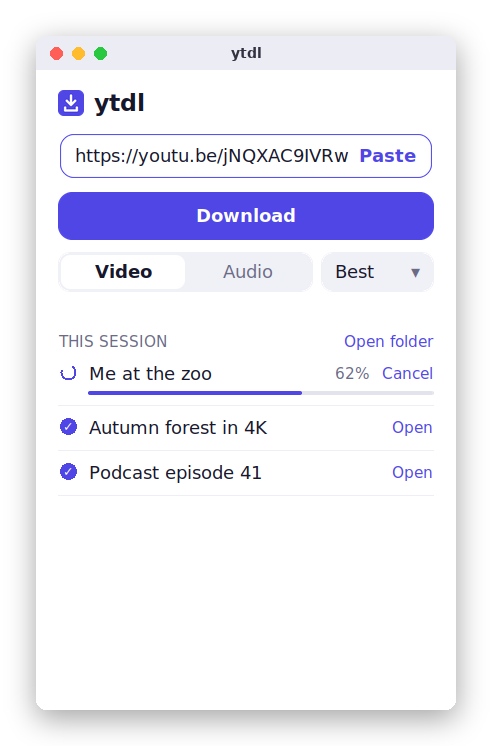 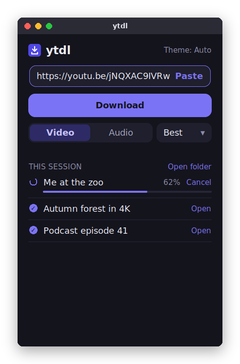 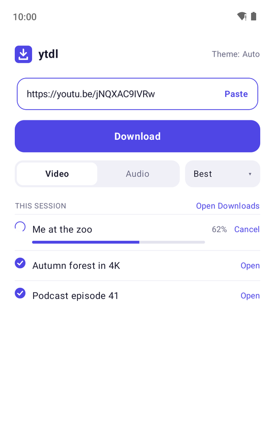 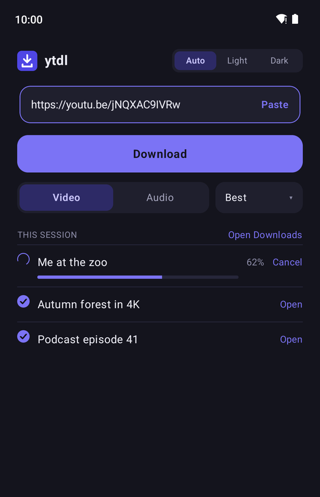</p>

| Platform | Download |
|---|---|
| Mac (Apple silicon) | `ytdl-minimal-mac-apple-silicon.dmg` |
| Mac (Intel) | `ytdl-minimal-mac-intel.dmg` |
| Windows | `ytdl-minimal-windows.exe` |
| Android | `ytdl-minimal-android.apk` |

Install steps are the same as the full app below. It works with the same sites, uses the same download engine (and keeps it updated quietly), and saves to `Downloads/ytdl`. What it leaves out on purpose: queues you manage, subscriptions, sign-in for private posts, clipping, subtitles, naming and folder rules, speed limits and storage controls. Channel and playlist links are refused with a note to use the full app. A copied link fills the box when you return to the app, but nothing downloads until you press **Download**. The code is in [`minimal/`](minimal).

## Screenshots

Real screenshots of the apps, filled with demo data.

<p align="center">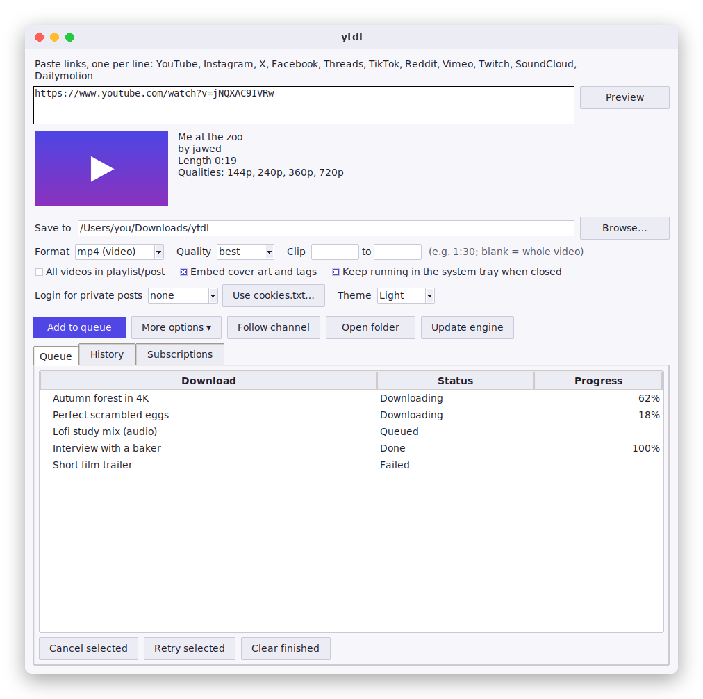 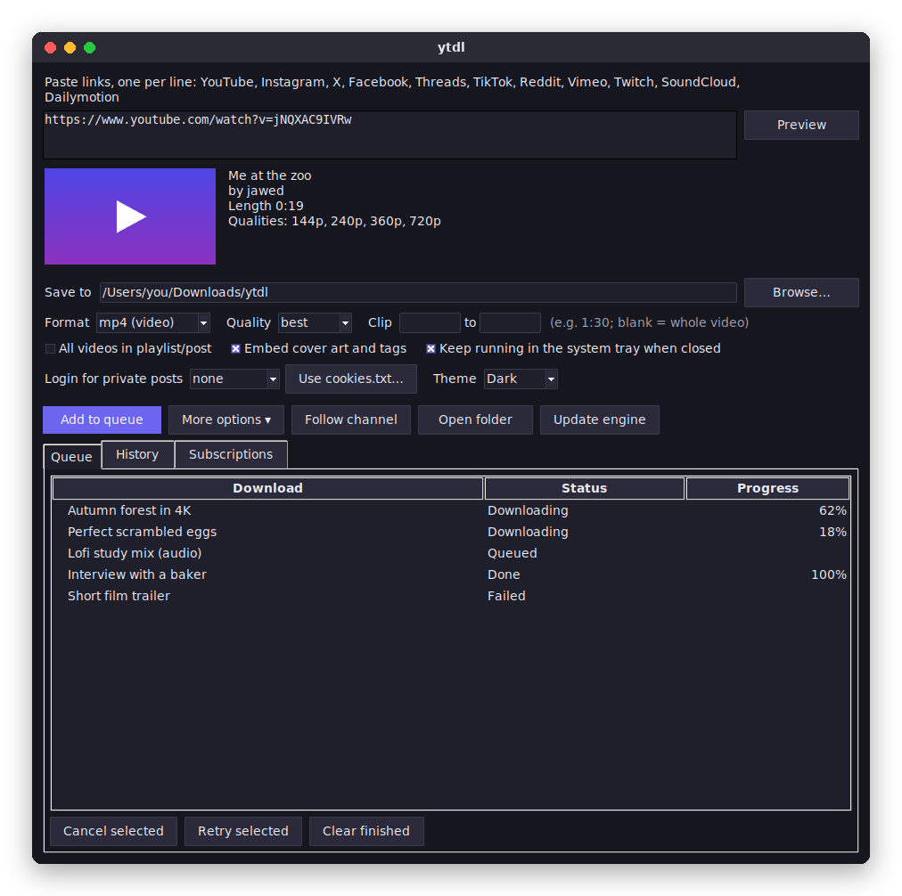</p>
<p align="center">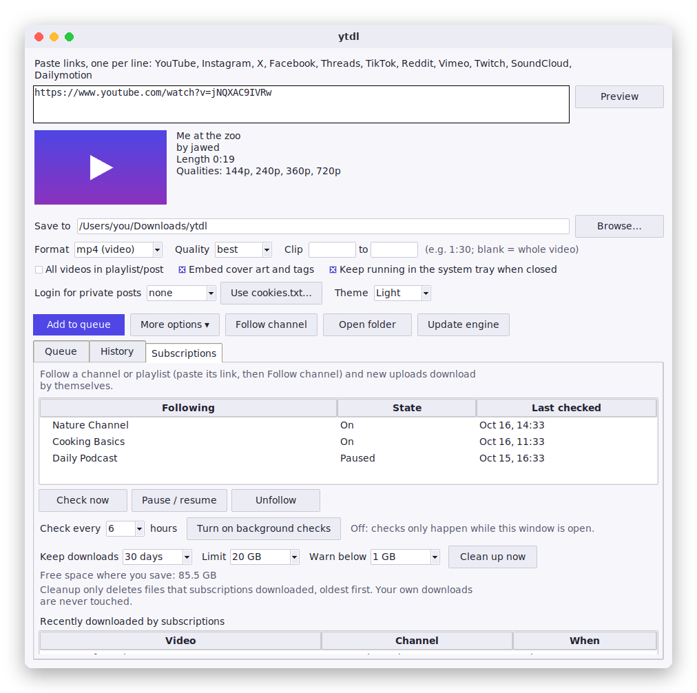</p>
<p align="center">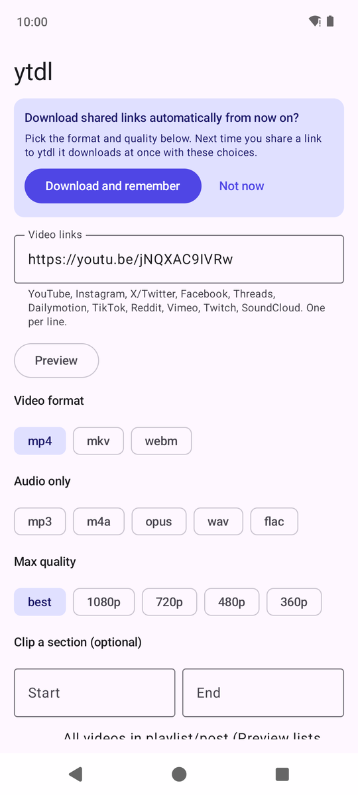 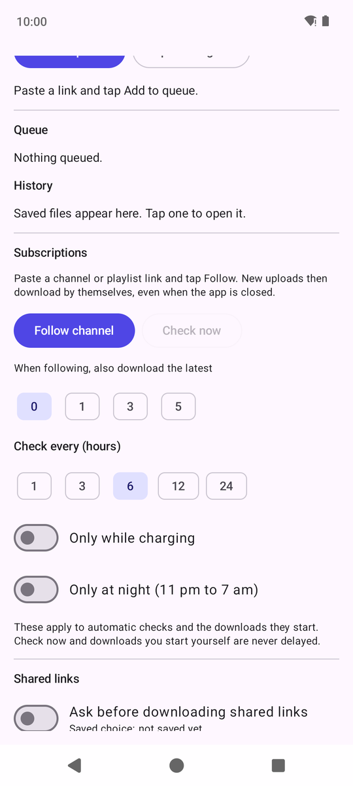 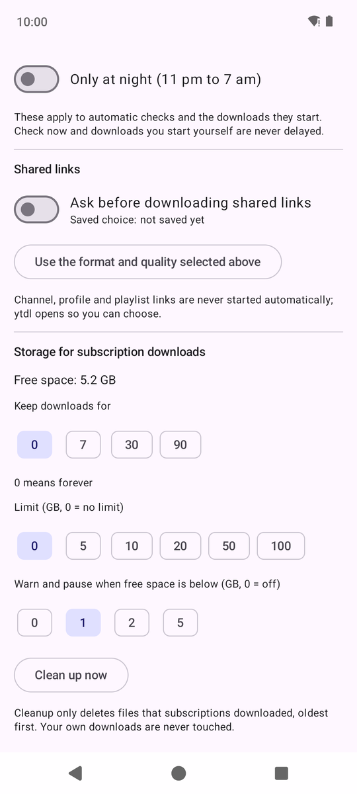 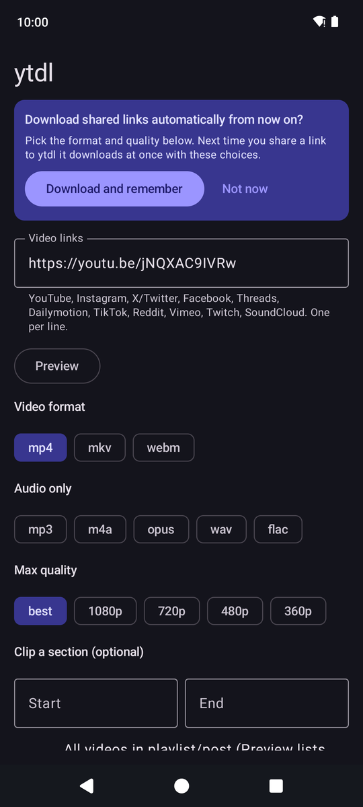</p>

## Install (no coding needed)

Open the [**Releases** page](https://github.com/biswadipb/ytdl/releases/latest) and download the file for your device.

### Mac
1. Download the file for your Mac: `ytdl-mac-apple-silicon.dmg` (M1/M2/M3/M4) or `ytdl-mac-intel.dmg` (older Intel).
   Not sure? Apple menu → About This Mac: "Chip: Apple…" means Apple silicon.
2. Open the dmg and drag **ytdl** onto the **Applications** shortcut. Then eject the disk image.
   (Prefer a zip? Each Mac also has a `.zip` containing `ytdl.app`; unzip it and drag the app to Applications.)
3. First launch only: the app is not signed by Apple, so macOS blocks it.
   Right-click **ytdl** → **Open** → **Open**. If macOS still refuses, run this once in Terminal:
   ```bash
   xattr -dr com.apple.quarantine /Applications/ytdl.app
   ```

### Windows
1. Download `ytdl-windows.exe` and double-click it.
2. If "Windows protected your PC" appears: **More info** → **Run anyway**
   (the app is not code-signed).

### Android
1. On your phone, open the Releases page and download `ytdl-android.apk`.
2. Open the file. Android asks you to allow installs from your browser or Files app: allow it, then tap **Install**.
   Needs Android 10 or newer.
3. Tip: in the YouTube app tap **Share → ytdl** to drop the link straight in.

## Using it

1. Paste one or more links. Tap **Preview** to see the title, thumbnail, length and available qualities first.
2. Pick a format (video or audio only), a quality, and optionally a clip (start and end times like `1:30` and `2:45`).
3. Tap **Add to queue**. Downloads run one after another, each with its own progress and a Cancel button. Finished files are listed under **History**.

Files go to `Downloads/ytdl` on every platform. Audio files get "(audio)" in their name so they never overwrite a video.

### Features

| Feature | Desktop | Android |
|---|---|---|
| Preview before downloading | Yes | Yes |
| Pick videos from a playlist | Yes | Yes |
| Download queue, cancel, history | Yes | Yes |
| Retry failed items, plus automatic retries | Yes | Yes |
| Several downloads at once, speed limit | Yes | Yes |
| File names and folders (per channel, per site) | Yes | Yes |
| Clip a section | Yes | Yes |
| Subtitles | Separate `.srt` or inside the video | Separate `.srt` |
| Cover art and tags embedded | mp3, m4a, opus, flac, mp4, mkv | mp3, opus, flac, mkv (tags for all) |
| Keeps going in the background | Downloads run while the window is open; closing asks first | Yes: a notification shows progress even with the app closed |
| "Finished" notification you can tap to open the file | n/a | Yes |
| Wi-Fi only / allow mobile data | n/a | Switch in the Network section (default Wi-Fi only) |
| Login for private posts | Your browser's login, or a `cookies.txt` file | Sign in inside the app |
| Copied link detected | Yes | Yes |
| Engine update | Yes, automatic at launch plus a button | Yes, automatic on Wi-Fi plus a button |
| Follow channels and playlists, new uploads download automatically | Yes, even when ytdl is closed (a scheduled job) | Yes, even when the app is closed (WorkManager) |
| Only while charging / only at night | n/a | Yes, for automatic downloads |
| Share a link from another app and it downloads at once | n/a | Yes, with the format you chose once |
| Storage controls: keep for N days, size limit, low-space warning | Yes | Yes |
| Tray / menu-bar icon, keeps working with the window closed | Yes | n/a (uses a notification) |
| Tells you when a new ytdl release is out | Yes | Yes |
| Theme | System / Light / Dark | System / Light / Dark |

**Subscriptions.** Paste a channel or playlist link and choose **Follow channel**. ytdl remembers what's already there, so only *new* uploads download (or also the latest 1 to 10 if you ask). It checks the newest 15 videos, retries failures a few times, and gives up on a video that keeps failing.
- *Desktop:* the **Subscriptions** tab lists what you follow. The window checks while it's open. Choose **Turn on background checks** to also register an hourly job with your computer (a LaunchAgent on Mac, Task Scheduler on Windows, cron on Linux), so downloads happen even when ytdl is closed. The Mac also shows a notification for each new video. From a terminal: `python main.py --subscribe URL`, `--subscriptions`, `--check-subscriptions`, `--schedule install`.
- *Android:* the **Subscriptions** section lists them. A background job runs about hourly. **Only while charging** and **Only at night (11 pm to 7 am)** limit when automatic checks run, and the job follows your Wi-Fi-only setting. Check now and downloads you start yourself are never delayed. Android decides the exact moment, so a check can be late, especially in battery saver.
- Works for YouTube channels and playlists, and for any playlist-style link the download engine can list. **Profiles on X, Threads and Facebook can't be followed**: they don't let ytdl list a profile's posts, and ytdl says so instead of failing oddly. Instagram profiles are attempted but need you to be signed in, and Instagram often blocks them anyway. Individual posts from all of these still download.

**Storage controls.** In the Subscriptions area you can keep downloads for 7, 30 or 90 days, set a size limit, and get a warning (and paused automatic downloads) when free space runs low. Cleanup only ever deletes files that *subscriptions* downloaded, oldest first, and asks before deleting when you press Clean up now. Your own downloads are never touched.

**Tray icon (desktop).** With "Keep running in the menu bar / system tray when closed" on (the default), closing the window hides it and ytdl keeps downloading and checking subscriptions. Click the icon to reopen, or choose Quit ytdl from its menu.

**Share from other apps (Android).** The first time you share a link to ytdl, it asks "Download shared links automatically from now on?". Choose the format and quality on screen and tap **Download and remember**. After that, sharing a single video, post or track from any app adds it to the queue straight away with a short confirmation, and you stay in the app you were using. Channel, profile and playlist links always open ytdl so you can decide. Change the saved choice, or turn it off, under *Shared links*.

**Playlists.** Tick "All videos in playlist/post" and tap **Preview**: you get a list to tick the videos you want, and each one becomes its own queue item.

**Speed and parallel downloads.** Under *More options* (desktop) or *Network* (Android) you can cap speed and run up to three downloads at once. The speed limit is shared between downloads that run together.

**Retries.** Failed items get a **Retry** button. Temporary problems such as a dropped connection are retried automatically (default twice); permanent ones such as private or removed videos are not.

**New versions.** On launch ytdl asks GitHub whether a newer release exists and shows a banner with a download link. It only tells you; it never installs anything by itself. Running from source skips the check.

**Login for private posts.**
Instagram, Facebook, Threads and some X posts refuse anonymous downloads.
- *Android:* in **Login for private posts**, tap a site, sign in, then tap "I'm signed in". Your login stays on the phone. YouTube isn't offered because Google blocks sign-in inside embedded browsers.
- *Desktop:* log in to the site in Chrome, Firefox, Safari, Edge or Brave and pick that browser under **Login for private posts**, or choose a `cookies.txt` file exported from your browser. On Mac you may see a Keychain prompt.

**Engine update.** Sites change often and the download engine (yt-dlp) must keep up. ytdl checks for a newer one and installs it by itself; on desktop it applies the next time you start the app.

**Theme:** System follows your device setting, and your choice is remembered.

## Command line (Mac / Windows)

```bash
cd desktop
python3 -m venv .venv && source .venv/bin/activate   # Windows: .venv\Scripts\activate
pip install -r requirements.txt
python main.py                      # opens the window
python main.py URL -F mp4 -q 720    # video
python main.py URL -F flac          # audio only
python main.py URL -c 1:30-2:45     # save only a section
python main.py URL -b chrome        # use your browser login
python main.py --update-engine      # fetch the newest yt-dlp (see --help for more)
```

## Building the apps yourself

Releases are built by GitHub Actions (`.github/workflows/build.yml`) when you push a tag:

```bash
git tag v1.0.1 && git push origin v1.0.1
```

Mac and Windows apps must be built on those systems, which is why CI does it.
Local Android build: open `android/` in Android Studio, or `cd android && ./gradlew :app:assembleDebug`.
The APK is debug-signed so it installs directly.

## Logo

Master design: `assets/logo.svg`. To regenerate the PNG, `.ico` and `.icns` files:
`pip install pillow && python assets/make_icons.py`.

## How Threads works

yt-dlp (the download engine) can't read Threads, and Threads only reveals a post's video files after its JavaScript has run. So ytdl loads the post in a browser in the background, reads the video links from the finished page, and downloads them like any other file. Only the first post on the page counts, so replies and suggested posts are ignored. Tick "All videos in playlist/post" to save every clip of a multi-video post.

This depends on how Threads builds its pages, so it can break when Threads changes. Cover art isn't embedded for Threads clips. If a Threads link fails, check that the post is public and has a video.

## Screenshots and website

The screenshots above come from CI, not mock-ups: the **Screenshots** workflow runs the real desktop window under a virtual display and the real Android app in an emulator (`tools/screenshots_desktop.py`, `tools/android_screens.sh`). The website is the `docs/` folder, published with GitHub Pages.

## Tests

Every push and every release runs automated checks: unit tests, real downloads of a generated test video through all eight formats (plus clipping, tags, naming, folders, speed limit, cancel, retry, subtitles, the engine updater, subscriptions with the background scheduler, and Threads pages), window tests, Android unit tests and lint. A release is only published if all of them pass, and the built Mac and Windows apps are started once before packaging.

```bash
cd desktop && pip install -r requirements.txt pytest && python -m pytest -q
```

## License

ytdl is free software under the [GNU General Public License v3.0](LICENSE). That license is required because the apps include GPL-licensed components (see below).

## Third-party software

See [THIRD_PARTY_NOTICES.md](THIRD_PARTY_NOTICES.md).

## How it works

Desktop apps wrap [yt-dlp](https://github.com/yt-dlp/yt-dlp) with a tkinter window and a bundled ffmpeg.
The Android app uses [youtubedl-android](https://github.com/yausername/youtubedl-android), which bundles yt-dlp and ffmpeg.
